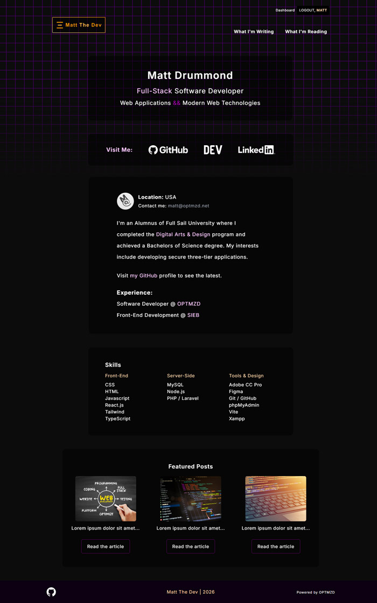
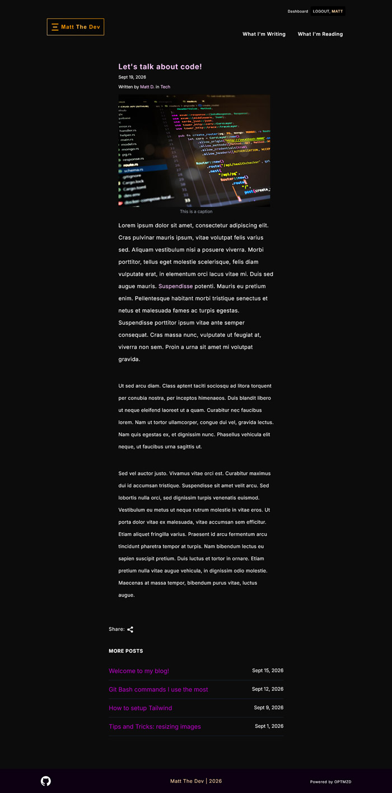
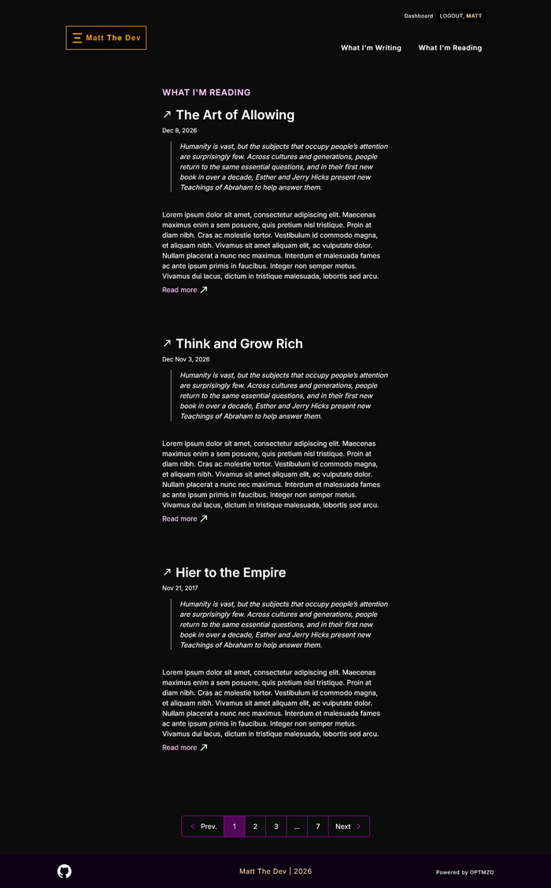
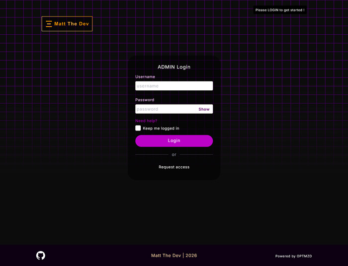
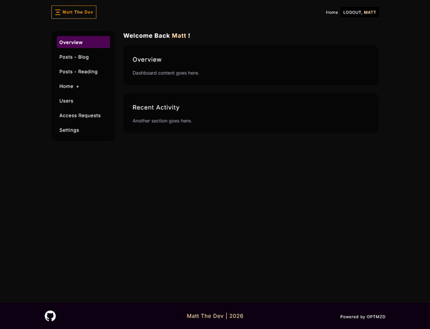
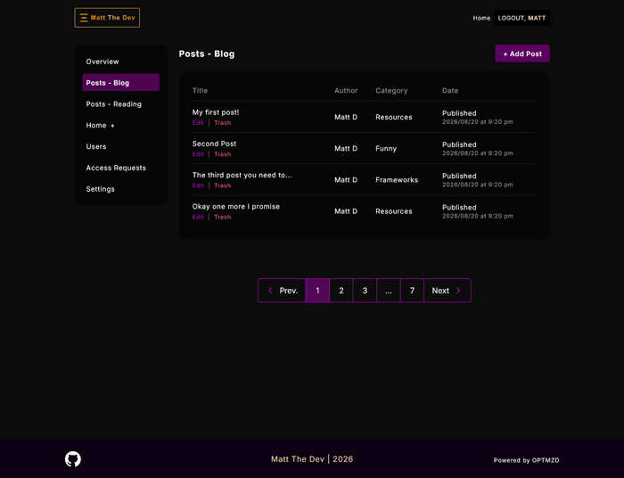
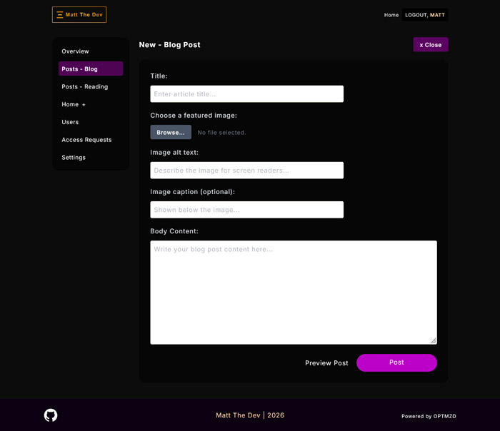
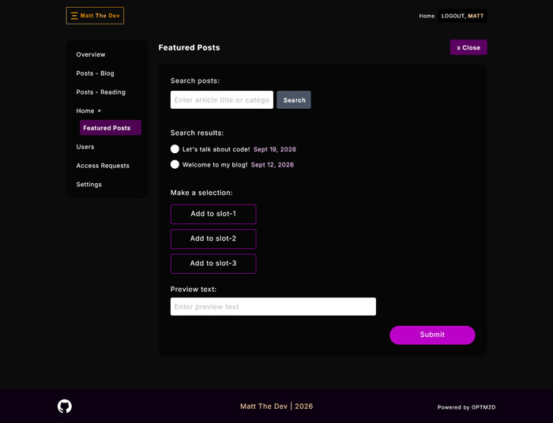
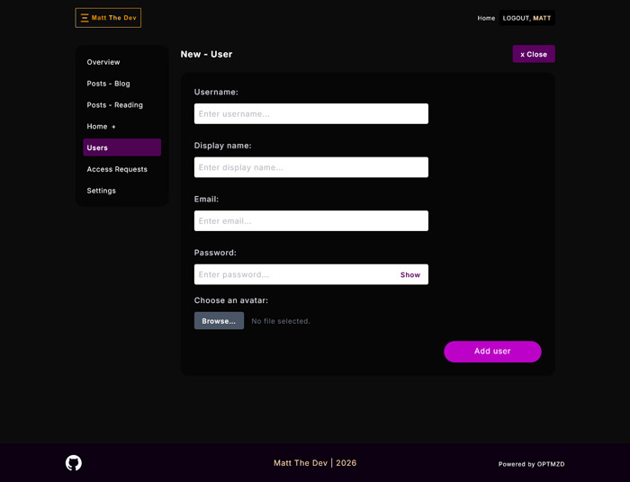
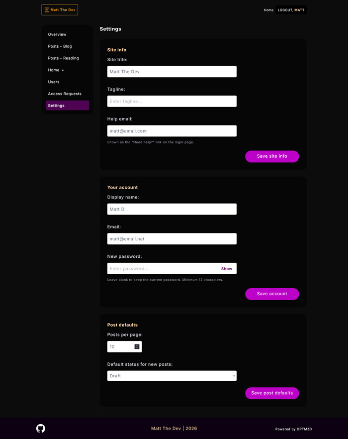

# Dynamic Blogging Application

A custom blogging platform with a public frontend and an admin CMS for managing posts. I'm building it to learn how the whole web stack fits together.

Built with help from Claude Code, which I used for explanations, planning and code review. I wrote the PHP myself.

**Stack:** Vite, Tailwind CSS v4, TypeScript, Figma. Backend: PHP (PDO) and MySQL (in progress).

**Security:** prepared statements for every query, CSRF tokens on every form, passwords hashed with `password_hash()`, hardened session cookies with inactivity timeouts, and login attempt limiting.

### Status
- [x] Visual design in Figma
- [x] Vite and Tailwind setup
- [x] Client-side frontend
- [x] Admin / CMS frontend
- [x] Apache htdocs migration / server-side preparation
- [x] Login system and sessions (login, logout, protected admin pages, "Keep me logged in", inactivity timeouts, CSRF tokens, login attempt limiting)
- [ ] Blog posts (in progress)
  - [x] Database table
  - [x] Admin list with trash, restore and permanent delete
  - [ ] New/edit form saving
  - [ ] Featured image upload
  - [ ] Public post pages

### Planned
- Reading posts, featured posts and user management
- Access requests and site settings
- Categories and comments tables
- JSON endpoints for features that don't reload the page (e.g. draft autosave)

### Running locally
1. Install [XAMPP](https://www.apachefriends.org/) and put the project in `htdocs/dynamic-blog`, so it's served at http://localhost/dynamic-blog/.
2. Run `npm install`, then `npm run build`. The `build/` folder isn't committed, so the pages have no CSS or JS until you build. While working, `npm run watch` rebuilds on every save.
3. In phpMyAdmin, create a database named `dynamicblog`, select it, and import `database_schema.sql` from the Import tab. That creates the `users`, `login_attempts` and `blog_posts` tables, with no data.
4. Copy `includes/dbh.inc.example.php` to `includes/dbh.inc.php` and fill in your database credentials. That file is gitignored.
5. Add an admin user by hand, with a password hash made by `password_hash()`. There's no signup page.

&nbsp;

### Screenshots - Client Side

&nbsp;

&nbsp;

&nbsp;

***

### Screenshots - Admin

&nbsp;

&nbsp;

&nbsp;

&nbsp;

&nbsp;

&nbsp;

